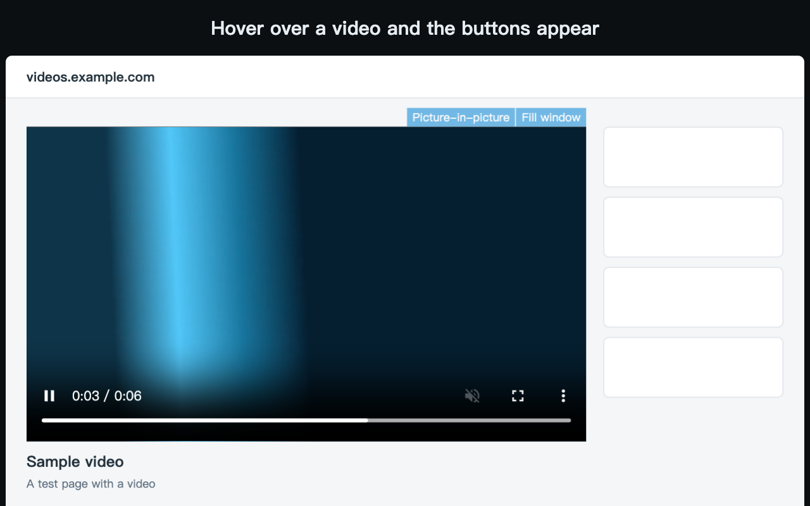
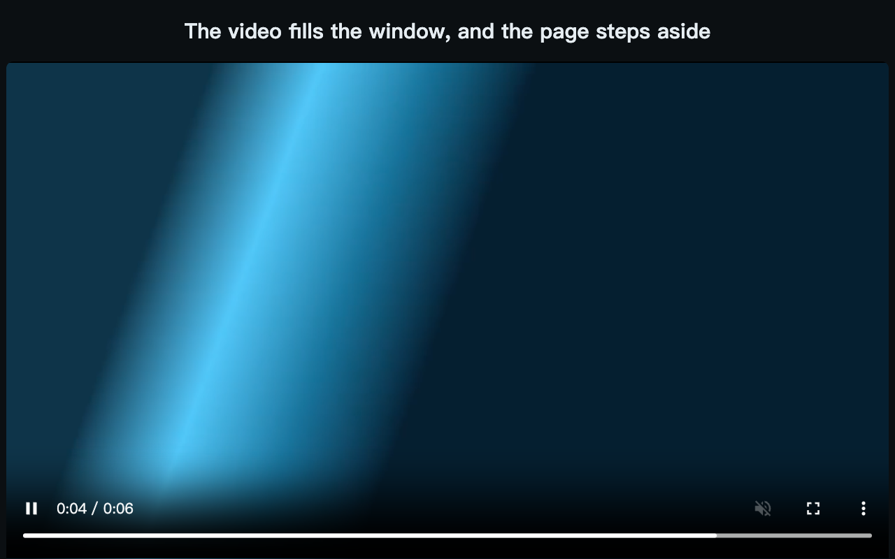

  

<h1 align="center">VFBS</h1>

  <b>Make any web video fill the browser window, or pop it out.</b> 
  A small Chrome extension. No account, no settings, nothing sent anywhere.

  English · <a href="README.zh-TW.md">繁體中文</a>

  

---

## What it is

Browser full screen takes over your whole display. VFBS keeps the video inside the window instead, so your other windows, tabs and the menu bar stay where they are. The page's header, comments and sidebars go out of the way until you come back.

## Features

- **Fill the window.** Hover over a video and press **Fill window** at its top right, or press <kbd>F2</kbd>.
- **Picture-in-picture.** Press the button next to it, or press <kbd>F3</kbd>.
- **Back in one step.** Press <kbd>F2</kbd> or <kbd>Esc</kbd>, or click the extension's icon. The page returns as it was.
- **Keeps the site's controls.** The site's own player fills the window when there is one, so its buttons still work.
- **Works across sites.** It finds videos on most pages, including ones inside frames and shadow DOM. It doesn't need a list of supported sites.

## Install

From the [Chrome Web Store](https://chromewebstore.google.com/detail/kehgaljpfggbgmljdnblnhcfcnacckih).

Or load it yourself:

1. Download this repository, or the zip from the latest release, and unzip it.
2. Open `chrome://extensions` and turn on **Developer mode**.
3. Choose **Load unpacked** and select the `extension` folder.

## Use it

1. Open a page with a video. There's nothing to set up.
2. Move the pointer over the video. The buttons appear at its top right.
3. Press **Fill window** or <kbd>F2</kbd> to fill the browser window, or **Picture-in-picture** or <kbd>F3</kbd> to pop the video out.
4. Press <kbd>F2</kbd> or <kbd>Esc</kbd>, or click the extension's icon, to go back.

  

## Limits

- **Small videos are skipped.** The buttons appear when at least 400 × 221 pixels of a video are in view.
- **Not on Google Search or account pages.** The extension doesn't run on Google Search, Google account pages or Firefox account pages.
- **Picture-in-picture can need a click.** A video inside a frame can ask you to click it first. A site can also turn picture-in-picture off for its video.
- **Chrome 116 or later.**

## Privacy and permissions

VFBS has no server and no analytics, and it sends nothing to its authors. It stores nothing and asks for no extra permissions. It runs on all sites because a video can be on any site. [SECURITY.md](SECURITY.md) has the details. The full [privacy policy](https://v-ax.com/privacy/vfbs/) is at v-ax.com.

## Contributing

See [CONTRIBUTING.md](CONTRIBUTING.md) for how to report a bug or send a change.

## License

The code is under the [MIT License](LICENSE). The icon isn't: see [BRAND.md](BRAND.md).

VFBS is an independent project. It is not made by, affiliated with or endorsed by Google. Chrome is a trademark of Google LLC.

Made by [V-AX](https://v-ax.com).
