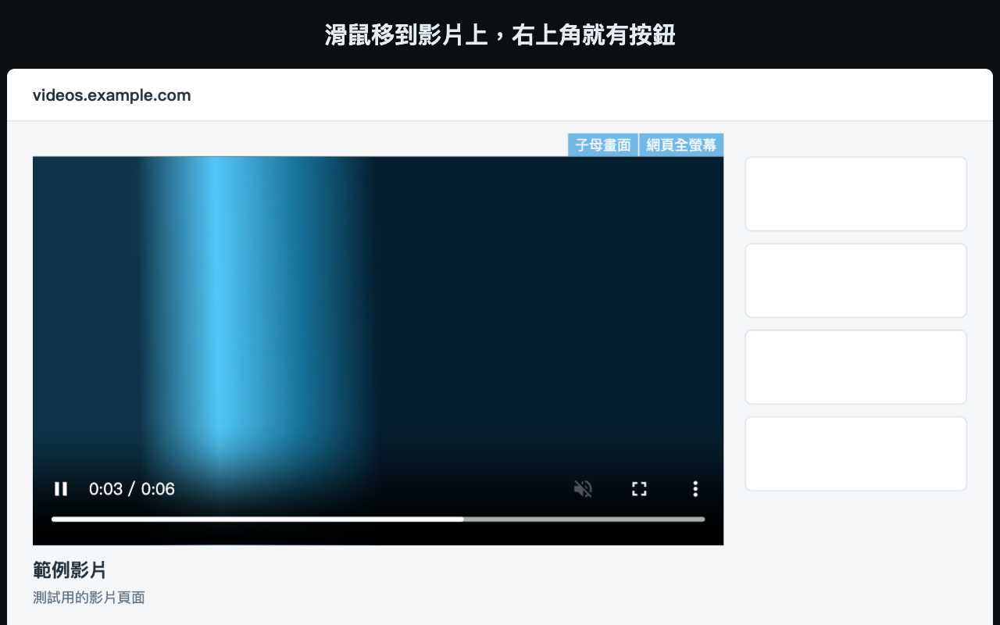
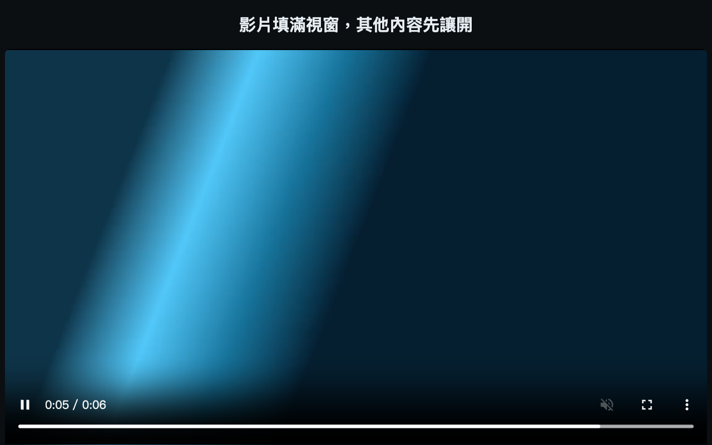

  

<h1 align="center">VFBS</h1>

  <b>讓網頁影片填滿瀏覽器視窗，或開成子母畫面。</b> 
  小巧的 Chrome 擴充功能。不用帳號、不用設定，也不會傳送任何資料。

  <a href="README.md">English</a> · 繁體中文

  

---

## 這是什麼

瀏覽器全螢幕會佔滿整個螢幕。VFBS 讓影片留在視窗內，其他視窗、分頁和選單列都維持原樣。頁面的頂端列、留言和側欄會先讓開，等你回來時再恢復。

## 功能

- **填滿視窗。** 滑鼠移到影片上，按右上角的「網頁全螢幕」，或按 <kbd>F2</kbd>。
- **子母畫面。** 按旁邊的按鈕，或按 <kbd>F3</kbd>。
- **一步回到原狀。** 按 <kbd>F2</kbd> 或 <kbd>Esc</kbd>，或點擴充功能圖示，頁面就會恢復原樣。
- **保留網站的控制列。** 有網站自己的播放器時，會讓整個播放器填滿視窗，原本的按鈕都能繼續用。
- **適用多數網站。** 能找到多數網頁的影片，包含框架和 Shadow DOM 內的影片，不需要支援網站清單。

## 安裝

從 [Chrome 線上應用程式商店](https://chromewebstore.google.com/detail/kehgaljpfggbgmljdnblnhcfcnacckih) 安裝。

也可以自行載入：

1. 下載這個 repository，或最新 release 的 zip，然後解壓縮。
2. 開啟 `chrome://extensions`，打開「開發人員模式」。
3. 選「載入未封裝項目」，選擇 `extension` 資料夾。

## 使用方式

1. 開啟有影片的網頁，不用任何設定。
2. 滑鼠移到影片上，右上角會出現按鈕。
3. 按「網頁全螢幕」或 <kbd>F2</kbd> 填滿瀏覽器視窗，按「子母畫面」或 <kbd>F3</kbd> 開成小視窗。
4. 按 <kbd>F2</kbd> 或 <kbd>Esc</kbd>，或點擴充功能圖示，就能回到原狀。

  

## 限制

- **太小的影片不會出現按鈕。** 影片在畫面內的部分至少要 400 × 221 像素。
- **Google 搜尋和帳號頁面不會執行。** Google 搜尋、Google 帳號和 Firefox 帳號頁面都不會執行。
- **子母畫面可能要先點一下。** 框架內的影片可能要先點擊才能開啟；網站也可以關閉影片的子母畫面功能。
- **需要 Chrome 116 以上。**

## 隱私與權限

VFBS 沒有伺服器，也沒有分析工具，不會傳送任何資料給作者，也不儲存任何資料，不需要額外權限。因為影片可能出現在任何網站，所以它會在所有網站上執行。詳細說明請見 [SECURITY.md](SECURITY.md)。完整的[隱私權政策](https://v-ax.com/privacy/vfbs/)在 v-ax.com。

## 參與貢獻

回報問題或提交修改的方式，請見 [CONTRIBUTING.md](CONTRIBUTING.md)。

## 授權

程式碼以 [MIT License](LICENSE) 釋出。圖示不在此授權內，見 [BRAND.md](BRAND.md)。

VFBS 是獨立專案，並非由 Google 製作，也與其沒有關係或背書。Chrome 是 Google LLC 的商標。

由 [V-AX](https://v-ax.com) 製作。
